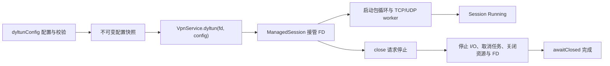
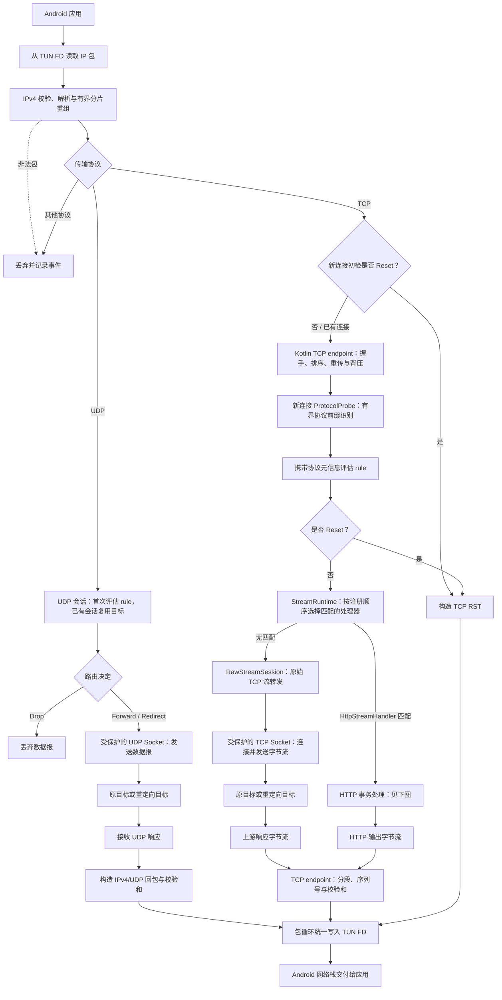
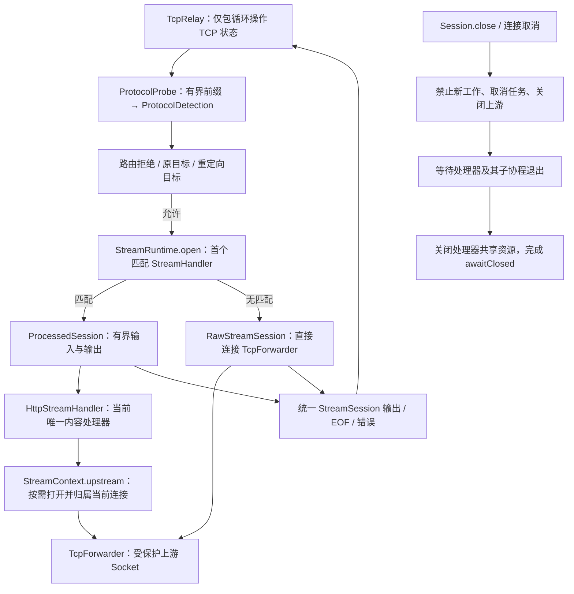
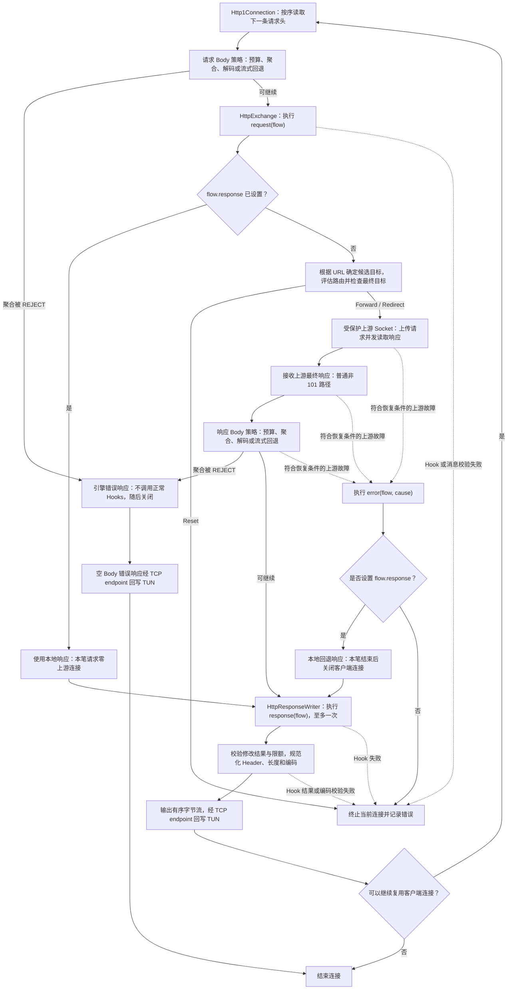

# 当前运行流程

依据当前 `0.1.0-SNAPSHOT` 实现绘制。图中展示正常数据路径、路由拒绝与 HTTP 本地/错误回退分支；队列、重传计时器等细节按职责合并。

## 初始化

行内 `dyltun(fd) { ... }` 先调用同一个配置工厂，再走相同启动路径。配置失败发生在 FD 接管前；异步启动失败进入 Failed 并清理资源。close 非阻塞且幂等，awaitClosed 等待完整清理。

## 数据面总览

- TCP 探测和连接选择发生在连接建立阶段；已有连接的数据沿选定处理路径继续传输。
- 初检没有协议元信息，只能执行依赖已满足的规则；协议探测完成后再次评估。
- 拒绝优先；没有拒绝时选择第一条 Forward/Redirect；没有决定则默认 Forward。
- TLS SNI 与 MQTT 识别提供路由元信息。TLS 不进行内容解密；MQTT 仍按原始 TCP 流转发。
- 当前只安装 HTTP 内容处理器，且仅在 hooks 非空时安装。处理器注册边界为 internal，尚未开放公共注册 API。
- 图中 Socket 节点合并了 protect、物理网络选择、连接和实际 I/O；protect 失败即终止该连接。

## TCP 处理器选择与生命周期

处理器通过 StreamContext 获得有序字节流、原连接信息、路由目标、探测结果与上游连接能力。探测不消费前缀；选择处理器后从完整客户端流开始读取。处理器输出仍须经 TCP endpoint 分段回写，不能直接写 TUN。

处理器路径入/出各 4 块、每块至多 16 KiB；慢消费者通过挂起读写施加背压。原始路径保留直接转发：上传按实际上游写入释放信用，下行按应用 ACK 补充上游读取额度。停止后仍未返回的同步 Hook 继续占用处理器连接名额，直到任务真正退出。

新增 TCP 内容协议时在组装处安装内部 StreamHandler，TcpRelay 无需增加协议分支。UDP 继续使用有边界的数据报路径；本次没有增加 MQTT 修改或公共处理器 SPI。内部契约与扩展步骤见 [STREAM_PROCESSORS.md](STREAM_PROCESSORS.md)。

## 普通 HTTP/1.1 事务

请求与响应的 Body 策略分别由 bodyLimits.request / response 控制，共享 Session 总预算。STREAM 回退和 OPAQUE 状态下不能修改 Body；Hook 结果和本地响应仍必须符合限额。

上游错误回退仅适用于允许恢复阶段的上游 I/O/响应 EOF。Hook 异常、协议校验错误、Body 拒绝、取消、已进入最终响应处理及升级后的故障均不进入 error Hook。回退响应仍执行一次 response Hook，同时保留原始连接错误事件。

图中合并或省略的特殊路径：

- Expect: 100-continue 在请求 Body 聚合前处理；上游中间响应按协议处理，不调用最终 response Hook。
- 上游 101 在校验协商字段并执行一次 response Hook 后，若仍保留有效 101，则切为双向原始流；Hook 替换为普通响应时进入普通响应输出，且不重复调用 response Hook。
- 上游早到最终响应可以取消未完成上传。正常 HTTP 请求以消息 framing 结束上传，不提前向上游发送 FIN。
- 未读完请求 Body 的本地响应、错误回退和引擎 REJECT 等分支发送响应后关闭客户端连接。
- 单笔上游 Socket 在事务结束时关闭，客户端满足持久连接条件时仍可处理下一请求。

## 职责与并发归属

| 部分 | 当前职责 |
|---|---|
| ManagedSession | Session 状态、停止、运行时与 FD 清理 |
| IpPacketRuntime / TcpRelay | 包循环、连接表、TCP 状态及唯一 TUN 写入 |
| TcpForwarder / UdpForwarder | TCP/UDP 各自的 Selector worker 与有界 I/O 队列 |
| ProtocolProbe / RoutingEvaluator | 有界前缀识别与连接动作评估 |
| StreamRuntime / StreamSession | 处理器选择、有界流桥接、任务取消、连接与上游资源归属 |
| RawStreamSession | 保留直接转发及按应用 ACK 释放下行信用 |
| HttpStreamHandler | HTTP 适配、Session Body 预算、HookExecutor 生命周期 |
| Http1Connection | 顺序事务循环、事务作用域与资源清理 |
| HttpExchange | 单次请求、本地/上游分支、错误恢复阶段与升级 |
| HttpResponseWriter | 响应 Hook、Body 准备、编码与输出 |
| HookExecutor | 受限工作执行器，运行宿主的同步 HTTP Hooks |
| ConnectionTrace / DnsNames | 记录连接诊断与有界被动 DNS 候选，错误时生成快照；不参与路由 |

协议处理器不直接操作 TUN 或 TCP 序列号。内部已有通用 TCP 处理边界；公共扩展仍为 ProtocolInspector / ConnectionRule，尚无公共内容处理器注册接口。

诊断沿上述数据路径收集：UDP 53 查询/回复 → DNS 候选；协议探测 → SNI/协议；HTTP 请求解析 → 原始 authority、方法与无 query 的路径；上游连接 → 选定目标与实际 peer。任一连接错误附加当前快照，原有转发与关闭分支不变。字段语义见 [API.md](API.md#84-连接错误上下文)。

公开配置和使用方式见 [API.md](API.md)，行为约束见 [DESIGN.md](DESIGN.md)。
